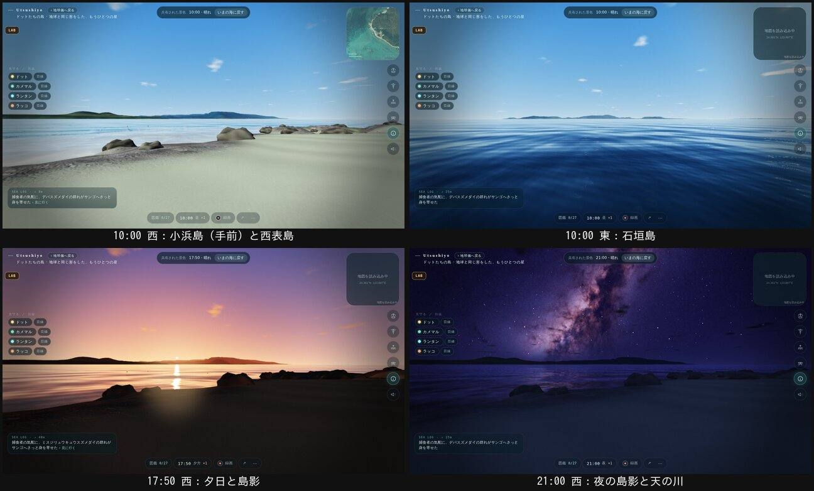

# 水平線の島影（2026-11-02、自然班）

始まりの島のオーナー決定（10/27、`../start-island-2026-10-27/DECISION.md` §3）の「水平線の島影」です。まわりの島を、地形のデータから作って水平線に見せます。見た目だけの変更です。

## 何を描くか
- **島**：小浜島（南のすぐ近くの島、南西に約 2.6 km）、西表島、石垣島、竹富島、黒島と、その間の小さな島（新城島など）。`src/world/planet-map.ts` の ISLES と同じ本物の位置です。
- **データ**：国土地理院の標高（dem_png）と航空写真（seamlessphoto）を、`scripts/bake-horizon.py` で格子に焼きます。
  - 小浜島：50 m 間隔（原点から 6 km 四方）
  - ほかの島：150 m 間隔
  - 嘉弥真島そのものは除きます（自分の地形で描かれているため）。
- **データの大きさ**：`public/land/horizon_*` の4枚で計 約 210 KB。
- **どちらの世界にも出す**：地球の嘉弥真と、ドットたちの世界の両方です（同じ形の星なので）。

## 描き方（`src/ocean/horizon.ts`）
- **見える距離**：カメラは 460 m 先までしか描かないので、島をそのまま置くと映りません。そこで、各点を本当の方向に保ったまま 300 m 先に描き、深さは一番奥にします。
  - 近くのもの（浜、木、海、住人）は、島の手前にふつうに描かれます。
  - 空・太陽・月は、島の後ろに隠れます。
  - 星も隠れます（`ocean/air.ts` で、星と惑星を一番奥に置き直しました）。
  - 島どうしは、本当の距離で前後が決まります。
- **地球の丸み**：遠い島ほど下に沈みます（大気の屈折を差し引いて d²/2R × 0.87）。
- **かすみ**：遠いほど、水平線の空の色に寄ります（晴れで 26 km、雨や曇りでは短く）。
- **光**：島の光は空気中の光（airLit）で当てるので、昼・夕方・夜で変わります。夜は月の光と空の明るさで、黒い影になります。
- **水中から**：カメラが水中にあるときは描きません。
- **乱数**：three.js が ID を引く乱数は、島影専用の乱数の流れから引きます。そのため、データがいつ届いても、世界の乱数（住人の日々）は変わりません。

## 確かめたこと
- **住民の指紋**：main 36262ee と1バイトも同じです。
- **画**（`tools/lab/horizon-look.cjs`、ドットたちの世界）：
  - 10:00：西・南・東
  - 17:50：西・南
  - 21:00：西・南
- **シェーダー**：`scripts/shader-check.mjs --all` を流しました。

## 確かめていないこと
- 本物の GPU・Windows での表示
- チラつき（`flicker.cjs`）：細い海岸線や遠い尾根は、カメラが動くとちらつくかもしれません。
- 重さ：島の格子は三角形 約6万で、いつも描きます。スマホでの速さは測っていません。
