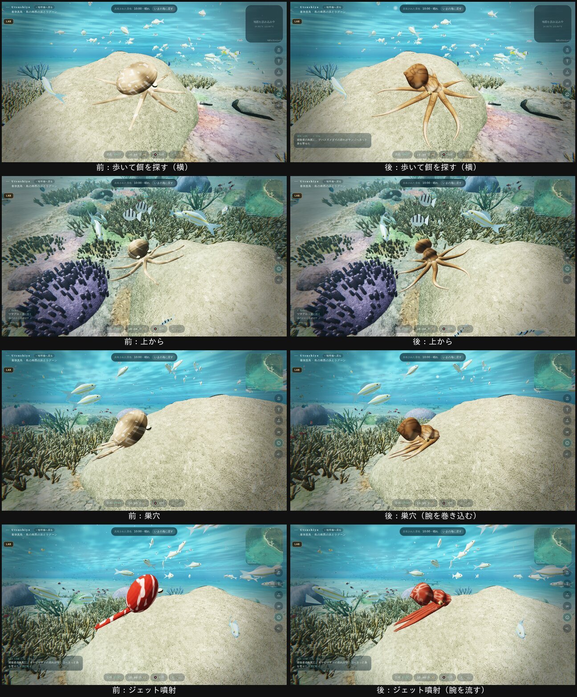

# タコの作り込み（2026-11-02、自然班）

オーナーのお願い：「色が変わるのはいいが、せっかくの軟体動物なのに簡易モデルっぽく、寄りで写すと見栄えが悪い。作り込んでほしい」。

## 変えたこと（`src/eco/octopus.ts`、ワモンダコ）

### 形
- **胴と頭**：外套膜の袋から首、目の盛り上がりを通って腕の付け根まで、一枚のなめらかな面でつなぎました。頭と腕の境に継ぎ目はありません。
- **目**：盛り上がりに埋め込みました。金色の虹彩に、横長の瞳孔です。
- **漏斗**：頭の横に付けました。
- **腕**：断面12角・長さ52節の細い管です。
  - 根元から先へ細くなり、腕先は細くとがります。
  - 口側（吸盤の側）は平たくしました。
- **膜**：腕の付け根どうしを、浅い膜でつなぎました。

### 腕の動き（頂点シェーダー）
- 腕ごとに、根元から24区間で中心線をたどって曲げます。
- **歩くとき**：うねりが腕の先へ伝わります。左右の腕は、うねりがずれます。
- **広げたとき**：腕は岩の上に沿って垂れ、腕先は持ち上がって横へ巻きます。
- **巣穴**：腕を縮めて、強く巻き込みます。
- **ジェット噴射**（`jet.jpg`）：本物と同じく外套膜（胴の袋）を先にして進みます。体はくるりと向きを変え、頭から外套膜までの線を進む向きにそろえます。腕は束になって後ろへ流れ、先が少し開きます。外套膜は噴射に合わせて縮みます（オーナーの参考画像より、11/2）。

### 皮膚
- **擬態の色**：岩の色を、温かく暗くした色です。大きなまだらと網目の暗い線（点の模様は使いません）でできています。
- **色の雲**：暗い色がゆっくり流れます。腕の上では、先へ向かって流れます。
- **警戒色**：落ち着いた赤褐色に、網目が淡く浮きます。
- **腕の裏**：淡い色で、吸盤の列は柔らかな畝として描きます（点の模様は使いません）。
- **質感**：柔らかく透ける縁の光と、濡れた控えめなつやを足しました。
- **細かいしわ**：画素より細かくなると消えるようにしました（`aaK`。チラつき対策）。

### 変えていないこと
- ふるまい（巣穴・歩く・ジェット噴射・色を合わせる）、大きさ、置き場所、被写体としての扱いは、前と同じです。ジェット噴射で変わったのは、体の向き（外套膜が先）だけです。進む向きと速さは前と同じです。
- 乱数：形を作るときに three.js が ID を引く回数を、前の形と同じにそろえました。そのため、世界の乱数（住人の日々）は変わりません。

## 確かめたこと
- **住民の指紋**：main 36262ee と1バイトも同じです。
- **シェーダー**：`node scripts/shader-check.mjs`（島・嘉弥真・礁の海、低・高画質、仕上げあり・なし）が PASS です。
- **画**（`tools/lab/octo-look.cjs`、嘉弥真の昼、約 1.1 m）：3つの状態を、横と上から撮りました。

## 確かめていないこと
- チラつき（`flicker.cjs`）
- 本物の GPU・Windows での表示
- 重さ：腕1本の頂点ごとに中心線を3回たどります（腕の頂点は 約5,500）。
